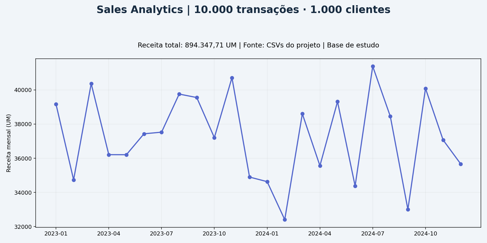

# Sales Analytics | Da base de vendas à decisão

**Python · SQLite · SQL · Dashboard HTML · Integração Power BI**

Projeto de portfólio que organiza 10 mil vendas em um fluxo executável: validação de CSVs, modelo dimensional SQLite, consultas, indicadores e dashboard com filtros de ano e região.



## Pergunta de negócio

Como acompanhar receita, volume, clientes e desempenho por período, região e categoria com indicadores definidos e reconciliados?

## Executar em poucos passos

Requer Python 3.12 para reproduzir o ambiente validado. O pipeline usa apenas a biblioteca padrão, sem instalação de pacotes.

```bash
git clone https://github.com/llfaraco/bi-end-to-end-sales-analytics.git
cd bi-end-to-end-sales-analytics
python src/pipeline.py
python -m unittest discover -s tests
# Opcional, com Node.js instalado:
node tests/dashboard.test.cjs
```

Abra `artifacts/dashboard.html` no navegador. O arquivo já está versionado e funciona sem servidor ou serviços externos. [Acessar o arquivo](artifacts/dashboard.html) → baixe o arquivo Raw e abra localmente.

## Resultados da execução local

| Indicador | Valor |
| --- | ---: |
| Transações | 10.000 |
| Clientes distintos | 1.000 |
| Unidades | 13.840 |
| Receita | 894.347,71 UM |
| Ticket por transação | 89,43 UM |
| Receita por unidade | 64,62 UM |
| Margem bruta estimada | 370.385,66 UM |
| Período | 01/01/2023 a 31/12/2024 |

A receita SQL foi reconciliada com a entrada. Tempo e hashes dos arquivos estão em [validation.json](artifacts/validation.json). O tempo registra uma execução nesta máquina; não é um benchmark comparativo.

## Fluxo e artefatos

1. Lê os quatro CSVs de origem e valida chaves, domínios, calendário e referências.
2. Deriva uma dimensão de clientes somente com IDs já presentes, sem criar atributos fictícios.
3. Carrega as dimensões e a fato no SQLite e confere integridade e receita.
4. Exporta CSV tratado, receita mensal, relatório de validação e dashboard HTML.
5. Disponibiliza [Power Query e instruções](powerbi/README.md) e [medidas DAX](pbix/dax_measures.txt) para Power BI Desktop.

| Caminho | Conteúdo |
| --- | --- |
| `src/pipeline.py` | Processamento e geração das saídas |
| `sql/` | Modelo dimensional e consultas analíticas |
| `tests/` | Contratos de dados, reexecução, totais e filtros |
| `artifacts/` | Dashboard e evidências medidas |
| `powerbi/` | Consulta M e roteiro para Desktop |
| `.github/workflows/ci.yml` | Verificações automáticas a cada push e pull request |

## Decisões e limites

- A moeda não está identificada: valores são **UM**.
- Ticket = receita ÷ transações; receita por unidade = receita ÷ unidades.
- A margem usa custo cadastrado, sem impostos, frete ou histórico de custo.
- Origem e licença da base de estudo precisam ser documentadas; não se atribuem estes dados a uma empresa real.
- O dashboard HTML foi gerado e sua lógica de filtros foi testada; o Power BI Desktop não foi executado. Não há `.pbix` entregue.
- Esta evolução foi construída com assistência de IA. Os resultados podem ser reproduzidos pelos comandos acima.

[Decisões técnicas](docs/DECISIONS.md) · [Dicionário de dados](docs/DATA_DICTIONARY.md) · [Portfólio](https://github.com/llfaraco)
